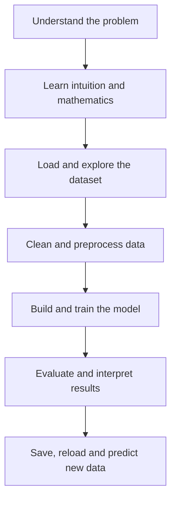

<!--
  CUSTOMIZATION
  1. Replace every YOUR_GITHUB_USERNAME with your GitHub username.
  2. Update project statuses as you complete them.
  3. Keep notebook paths synchronized with the folders in this roadmap.
-->

<p align="center">
  
</p>

<div align="center"> 
 
# Learn Machine Learning Through 44 Practical Projects

### Theory · Mathematics · Intuition · Code · Evaluation · Real-World Practice

<p>
  <a href="#-project-roadmap"></a>
  
  
  
</p>

<p>
  
  
  
  
  
  
</p>

<a href="https://colab.research.google.com/github/YOUR_GITHUB_USERNAME/learn-machine-learning-with-44-projects/blob/main/projects/01-simple-linear-regression/01_simple_linear_regression.ipynb">
  
</a>

<br />

<em>A project-first, beginner-friendly path from linear regression to recommender systems.</em>

</div>

---

## About This Repository

This repository teaches **essential classical machine-learning algorithms and techniques through 44 independent, practical projects**. Every project has its own folder and a self-contained Google Colab notebook that can be opened and executed from beginning to end.

The goal is not only to call `.fit()` and print a score. Each project connects:

> **Concept → Intuition → Mathematics → Data → Implementation → Evaluation → Interpretation → Prediction**

<table>
  <tr>
    <td align="center" width="25%">
      <strong>44 Projects</strong><br />
      One focused project for every essential algorithm or technique
    </td>
    <td align="center" width="25%">
      <strong>Colab First</strong><br />
      Run every notebook online without local setup
    </td>
    <td align="center" width="25%">
      <strong>Complete Explanations</strong><br /> 
      Theory, mathematics, code and common mistakes
    </td>
    <td align="center" width="25%">
      <strong>Portfolio Ready</strong><br />
      Real datasets, evaluation, visualizations and conclusions
    </td>
  </tr>
</table>

> [!NOTE]
> Machine learning contains hundreds of algorithms. This repository focuses on **44 essential classical ML algorithms and applied techniques**. Deep learning, LLMs, computer vision and agentic AI will be developed as separate learning collections.

---

## Table of Contents

- [About This Repository](#about-this-repository)
- [Learning Workflow](#-learning-workflow)
- [What Every Project Contains](#-what-every-project-contains)
- [Repository Structure](#-repository-structure)
- [Project Roadmap](#-project-roadmap)
  - [Regression](#1-regression-projects-0113)
  - [Classification](#2-classification-projects-1428)
  - [Clustering and Dimensionality Reduction](#3-clustering-and-dimensionality-reduction-projects-2935)
  - [Anomaly Detection](#4-anomaly-detection-projects-3638)
  - [Association Rules](#5-association-rule-learning-projects-3940)
  - [Recommendation Systems](#6-recommendation-system-projects-4144)
- [Getting Started](#-getting-started)
- [Project Quality Standard](#-project-quality-standard)
- [Progress](#-progress)
- [Contributing](#-contributing)
- [Author](#-author)
- [License](#-license)
  
---

## 🚀 Learning Workflow



Every notebook follows this workflow so that the repository remains consistent and easy to study.

---

## 🧩 What Every Project Contains

Each Colab notebook is designed as a complete mini-course:

| Stage | Included material |
|---|---|
| **1. Foundations** | Problem statement, learning objectives, algorithm definition and intuition |
| **2. Mathematics** | Formula, parameters, assumptions and step-by-step explanation |
| **3. Practical context** | Applications, advantages, disadvantages, when to use and when not to use |
| **4. Dataset** | Source, license, columns, features, target and download instructions |
| **5. Data analysis** | Data inspection, missing values, duplicates, statistics, EDA and visualizations |
| **6. Preprocessing** | Splitting, scaling, encoding, transformations and leakage prevention |
| **7. Implementation** | From-scratch version when practical and library-based implementation |
| **8. Training** | Model configuration, hyperparameters, training process and learning behavior |
| **9. Evaluation** | Correct metrics, plots, error analysis and result interpretation |
| **10. Production basics** | Prediction function, model saving, model loading and reproducibility |
| **11. Study support** | Common errors, interview questions, exercises and conclusion |

---

## 🗂️ Repository Structure

```text
learn-machine-learning-with-44-projects/
│
├── README.md
├── LICENSE
├── ROADMAP.md
│
└── projects/
    ├── 01-simple-linear-regression/
    │   ├── README.md
    │   └── 01_simple_linear_regression.ipynb
    │
    ├── 02-multiple-linear-regression/
    │   ├── README.md
    │   └── 02_multiple_linear_regression.ipynb
    │
    ├── 03-polynomial-regression/
    │   ├── README.md
    │   └── 03_polynomial_regression.ipynb
    │
    ├── ...
    │
    └── 44-matrix-factorization-svd/
        ├── README.md
        └── 44_matrix_factorization_svd.ipynb
```

Each folder is independent. Open its notebook in Colab and select **Runtime → Run all**.

---

## 🧭 Project Roadmap

### Status Legend

| Symbol | Status |
|:---:|---|
| ✅ | Completed |
| 🚧 | In progress | 
| ⬜ | Planned |

### 1. Regression Projects 01–13

Predict continuous values such as salary, price, quality, demand or revenue.

| # | Algorithm | Practical project | Dataset | Colab | Status |
|---:|---|---|---|:---:|:---:|
| 01 | Simple Linear Regression | Salary prediction from experience | [Salary Dataset](https://www.kaggle.com/datasets/abhishek14398/salary-dataset-simple-linear-regression) | [](https://colab.research.google.com/github/YOUR_GITHUB_USERNAME/learn-machine-learning-with-44-projects/blob/main/projects/01-simple-linear-regression/01_simple_linear_regression.ipynb) | ✅ |
| 02 | Multiple Linear Regression | House-price prediction | [California Housing](https://www.kaggle.com/datasets/camnugent/california-housing-prices) | [](https://colab.research.google.com/github/YOUR_GITHUB_USERNAME/learn-machine-learning-with-44-projects/blob/main/projects/02-multiple-linear-regression/02_multiple_linear_regression.ipynb) | ⬜ |
| 03 | Polynomial Regression | Nonlinear salary prediction | [Salary Prediction](https://www.kaggle.com/datasets/rkiattisak/salaly-prediction-for-beginer) | [](https://colab.research.google.com/github/YOUR_GITHUB_USERNAME/learn-machine-learning-with-44-projects/blob/main/projects/03-polynomial-regression/03_polynomial_regression.ipynb) | ⬜ |
| 04 | Ridge Regression | Regularized house-price prediction | [California Housing](https://www.kaggle.com/datasets/camnugent/california-housing-prices) | [](https://colab.research.google.com/github/YOUR_GITHUB_USERNAME/learn-machine-learning-with-44-projects/blob/main/projects/04-ridge-regression/04_ridge_regression.ipynb) | ⬜ |
| 05 | Lasso Regression | Price prediction with feature selection | [Housing Prices](https://www.kaggle.com/datasets/yasserh/housing-prices-dataset) | [](https://colab.research.google.com/github/YOUR_GITHUB_USERNAME/learn-machine-learning-with-44-projects/blob/main/projects/05-lasso-regression/05_lasso_regression.ipynb) | ⬜ |
| 06 | Elastic Net | Combined L1 and L2 regularization | [Housing Prices](https://www.kaggle.com/datasets/yasserh/housing-prices-dataset) | [](https://colab.research.google.com/github/YOUR_GITHUB_USERNAME/learn-machine-learning-with-44-projects/blob/main/projects/06-elastic-net/06_elastic_net.ipynb) | ⬜ |
| 07 | Support Vector Regression | Wine-quality prediction | [Wine Quality](https://www.kaggle.com/datasets/yasserh/wine-quality-dataset) | [](https://colab.research.google.com/github/YOUR_GITHUB_USERNAME/learn-machine-learning-with-44-projects/blob/main/projects/07-support-vector-regression/07_support_vector_regression.ipynb) | ⬜ |
| 08 | Decision Tree Regressor | Rule-based house-price prediction | [House Values](https://www.kaggle.com/datasets/prokshitha/home-value-insights) | [](https://colab.research.google.com/github/YOUR_GITHUB_USERNAME/learn-machine-learning-with-44-projects/blob/main/projects/08-decision-tree-regressor/08_decision_tree_regressor.ipynb) | ⬜ |
| 09 | Random Forest Regressor | Ensemble house-price prediction | [California Housing](https://www.kaggle.com/datasets/camnugent/california-housing-prices) | [](https://colab.research.google.com/github/YOUR_GITHUB_USERNAME/learn-machine-learning-with-44-projects/blob/main/projects/09-random-forest-regressor/09_random_forest_regressor.ipynb) | ⬜ |
| 10 | Gradient Boosting Regressor | Advanced house-price prediction | [Housing Regression](https://www.kaggle.com/datasets/denkuznetz/housing-prices-regression) | [](https://colab.research.google.com/github/YOUR_GITHUB_USERNAME/learn-machine-learning-with-44-projects/blob/main/projects/10-gradient-boosting-regressor/10_gradient_boosting_regressor.ipynb) | ⬜ |
| 11 | XGBoost Regressor | Production-style price prediction | [Housing Prices](https://www.kaggle.com/datasets/yasserh/housing-prices-dataset) | [](https://colab.research.google.com/github/YOUR_GITHUB_USERNAME/learn-machine-learning-with-44-projects/blob/main/projects/11-xgboost-regressor/11_xgboost_regressor.ipynb) | ⬜ |
| 12 | LightGBM Regressor | Fast tabular price prediction | [California Housing](https://www.kaggle.com/datasets/camnugent/california-housing-prices) | [](https://colab.research.google.com/github/YOUR_GITHUB_USERNAME/learn-machine-learning-with-44-projects/blob/main/projects/12-lightgbm-regressor/12_lightgbm_regressor.ipynb) | ⬜ |
| 13 | CatBoost Regressor | Salary prediction with categories | [Salary Data](https://www.kaggle.com/datasets/mohithsairamreddy/salary-data) | [](https://colab.research.google.com/github/YOUR_GITHUB_USERNAME/learn-machine-learning-with-44-projects/blob/main/projects/13-catboost-regressor/13_catboost_regressor.ipynb) | ⬜ |

<p align="right"><a href="#table-of-contents">Back to top ↑</a></p>

### 2. Classification Projects 14–28

Predict labels such as yes/no, fraud/legitimate, churn/stay or one of several categories.

<details open>
<summary><strong>View all 15 classification projects</strong></summary>

| # | Algorithm | Practical project | Dataset | Colab | Status |
|---:|---|---|---|:---:|:---:|
| 14 | Logistic Regression | Titanic-survival prediction | [Titanic](https://www.kaggle.com/datasets/yasserh/titanic-dataset) | [](https://colab.research.google.com/github/YOUR_GITHUB_USERNAME/learn-machine-learning-with-44-projects/blob/main/projects/14-logistic-regression/14_logistic_regression.ipynb) | ⬜ |
| 15 | K-Nearest Neighbors | Iris-species classification | [Iris](https://www.kaggle.com/datasets/uciml/iris) | [](https://colab.research.google.com/github/YOUR_GITHUB_USERNAME/learn-machine-learning-with-44-projects/blob/main/projects/15-k-nearest-neighbors/15_k_nearest_neighbors.ipynb) | ⬜ |
| 16 | Gaussian Naive Bayes | Diabetes prediction | [Diabetes](https://www.kaggle.com/datasets/iammustafatz/diabetes-prediction-dataset) | [](https://colab.research.google.com/github/YOUR_GITHUB_USERNAME/learn-machine-learning-with-44-projects/blob/main/projects/16-gaussian-naive-bayes/16_gaussian_naive_bayes.ipynb) | ⬜ |
| 17 | Multinomial Naive Bayes | SMS-spam detection | [SMS Spam](https://www.kaggle.com/datasets/uciml/sms-spam-collection-dataset) | [](https://colab.research.google.com/github/YOUR_GITHUB_USERNAME/learn-machine-learning-with-44-projects/blob/main/projects/17-multinomial-naive-bayes/17_multinomial_naive_bayes.ipynb) | ⬜ |
| 18 | Decision Tree Classifier | Loan-approval prediction | [Loan Approval](https://www.kaggle.com/datasets/architsharma01/loan-approval-prediction-dataset) | [](https://colab.research.google.com/github/YOUR_GITHUB_USERNAME/learn-machine-learning-with-44-projects/blob/main/projects/18-decision-tree-classifier/18_decision_tree_classifier.ipynb) | ⬜ |
| 19 | Support Vector Machine | Breast-cancer classification | [Breast Cancer](https://www.kaggle.com/datasets/uciml/breast-cancer-wisconsin-data) | [](https://colab.research.google.com/github/YOUR_GITHUB_USERNAME/learn-machine-learning-with-44-projects/blob/main/projects/19-support-vector-machine/19_support_vector_machine.ipynb) | ⬜ |
| 20 | Random Forest Classifier | Customer-churn prediction | [Telco Churn](https://www.kaggle.com/datasets/blastchar/telco-customer-churn) | [](https://colab.research.google.com/github/YOUR_GITHUB_USERNAME/learn-machine-learning-with-44-projects/blob/main/projects/20-random-forest-classifier/20_random_forest_classifier.ipynb) | ⬜ |
| 21 | Extra Trees Classifier | Randomized ensemble comparison | [Telco Churn](https://www.kaggle.com/datasets/blastchar/telco-customer-churn) | [](https://colab.research.google.com/github/YOUR_GITHUB_USERNAME/learn-machine-learning-with-44-projects/blob/main/projects/21-extra-trees-classifier/21_extra_trees_classifier.ipynb) | ⬜ |
| 22 | Bagging Classifier | Stable wine-quality classification | [Wine Quality](https://www.kaggle.com/datasets/yasserh/wine-quality-dataset) | [](https://colab.research.google.com/github/YOUR_GITHUB_USERNAME/learn-machine-learning-with-44-projects/blob/main/projects/22-bagging-classifier/22_bagging_classifier.ipynb) | ⬜ |
| 23 | AdaBoost | Boosted loan-approval prediction | [Loan Approval](https://www.kaggle.com/datasets/architsharma01/loan-approval-prediction-dataset) | [](https://colab.research.google.com/github/YOUR_GITHUB_USERNAME/learn-machine-learning-with-44-projects/blob/main/projects/23-adaboost/23_adaboost.ipynb) | ⬜ |
| 24 | Gradient Boosting Classifier | Customer-churn prediction | [Telco Churn](https://www.kaggle.com/datasets/blastchar/telco-customer-churn) | [](https://colab.research.google.com/github/YOUR_GITHUB_USERNAME/learn-machine-learning-with-44-projects/blob/main/projects/24-gradient-boosting-classifier/24_gradient_boosting_classifier.ipynb) | ⬜ |
| 25 | XGBoost Classifier | Advanced churn prediction | [Telco Churn](https://www.kaggle.com/datasets/blastchar/telco-customer-churn) | [](https://colab.research.google.com/github/YOUR_GITHUB_USERNAME/learn-machine-learning-with-44-projects/blob/main/projects/25-xgboost-classifier/25_xgboost_classifier.ipynb) | ⬜ |
| 26 | LightGBM Classifier | Large-scale churn prediction | [Customer Churn](https://www.kaggle.com/datasets/muhammadshahidazeem/customer-churn-dataset) | [](https://colab.research.google.com/github/YOUR_GITHUB_USERNAME/learn-machine-learning-with-44-projects/blob/main/projects/26-lightgbm-classifier/26_lightgbm_classifier.ipynb) | ⬜ |
| 27 | CatBoost Classifier | Categorical loan prediction | [Loan Prediction](https://www.kaggle.com/datasets/ninzaami/loan-predication) | [](https://colab.research.google.com/github/YOUR_GITHUB_USERNAME/learn-machine-learning-with-44-projects/blob/main/projects/27-catboost-classifier/27_catboost_classifier.ipynb) | ⬜ |
| 28 | LDA and QDA | Statistical classifier comparison | [Iris](https://www.kaggle.com/datasets/uciml/iris) | [](https://colab.research.google.com/github/YOUR_GITHUB_USERNAME/learn-machine-learning-with-44-projects/blob/main/projects/28-discriminant-analysis/28_discriminant_analysis.ipynb) | ⬜ |

</details>

<p align="right"><a href="#table-of-contents">Back to top ↑</a></p>

### 3. Clustering and Dimensionality Reduction Projects 29–35

Discover hidden groups, reduce dimensions and visualize high-dimensional data.

<details open>
<summary><strong>View all 7 unsupervised-learning projects</strong></summary>

| # | Algorithm or technique | Practical project | Dataset | Colab | Status |
|---:|---|---|---|:---:|:---:|
| 29 | K-Means Clustering | Customer segmentation | [Mall Customers](https://www.kaggle.com/datasets/vjchoudhary7/customer-segmentation-tutorial-in-python) | [](https://colab.research.google.com/github/YOUR_GITHUB_USERNAME/learn-machine-learning-with-44-projects/blob/main/projects/29-k-means/29_k_means.ipynb) | ⬜ |
| 30 | Hierarchical Clustering | Customer hierarchy analysis | [Mall Customers](https://www.kaggle.com/datasets/vjchoudhary7/customer-segmentation-tutorial-in-python) | [](https://colab.research.google.com/github/YOUR_GITHUB_USERNAME/learn-machine-learning-with-44-projects/blob/main/projects/30-hierarchical-clustering/30_hierarchical_clustering.ipynb) | ⬜ |
| 31 | DBSCAN | Cluster and outlier detection | [Customer Segmentation](https://www.kaggle.com/datasets/zubairmustafa/shopping-mall-customer-segmentation-data) | [](https://colab.research.google.com/github/YOUR_GITHUB_USERNAME/learn-machine-learning-with-44-projects/blob/main/projects/31-dbscan/31_dbscan.ipynb) | ⬜ |
| 32 | Gaussian Mixture Model | Soft customer segmentation | [Mall Customers](https://www.kaggle.com/datasets/vjchoudhary7/customer-segmentation-tutorial-in-python) | [](https://colab.research.google.com/github/YOUR_GITHUB_USERNAME/learn-machine-learning-with-44-projects/blob/main/projects/32-gaussian-mixture-model/32_gaussian_mixture_model.ipynb) | ⬜ |
| 33 | Principal Component Analysis | Wine-feature reduction | [Wine Quality](https://www.kaggle.com/datasets/yasserh/wine-quality-dataset) | [](https://colab.research.google.com/github/YOUR_GITHUB_USERNAME/learn-machine-learning-with-44-projects/blob/main/projects/33-principal-component-analysis/33_principal_component_analysis.ipynb) | ⬜ |
| 34 | t-SNE | Cancer-data visualization | [Breast Cancer](https://www.kaggle.com/datasets/uciml/breast-cancer-wisconsin-data) | [](https://colab.research.google.com/github/YOUR_GITHUB_USERNAME/learn-machine-learning-with-44-projects/blob/main/projects/34-t-sne/34_t_sne.ipynb) | ⬜ |
| 35 | UMAP | High-dimensional wine visualization | [Wine Quality](https://www.kaggle.com/datasets/yasserh/wine-quality-dataset) | [](https://colab.research.google.com/github/YOUR_GITHUB_USERNAME/learn-machine-learning-with-44-projects/blob/main/projects/35-umap/35_umap.ipynb) | ⬜ |

</details>

<p align="right"><a href="#table-of-contents">Back to top ↑</a></p>

### 4. Anomaly Detection Projects 36–38

Identify unusual or suspicious observations such as fraudulent transactions.

| # | Algorithm | Practical project | Dataset | Colab | Status |
|---:|---|---|---|:---:|:---:|
| 36 | Isolation Forest | Credit-card fraud detection | [Credit Card Fraud](https://www.kaggle.com/datasets/mlg-ulb/creditcardfraud) | [](https://colab.research.google.com/github/YOUR_GITHUB_USERNAME/learn-machine-learning-with-44-projects/blob/main/projects/36-isolation-forest/36_isolation_forest.ipynb) | ⬜ |
| 37 | Local Outlier Factor | Transaction-outlier detection | [Credit Card Fraud](https://www.kaggle.com/datasets/mlg-ulb/creditcardfraud) | [](https://colab.research.google.com/github/YOUR_GITHUB_USERNAME/learn-machine-learning-with-44-projects/blob/main/projects/37-local-outlier-factor/37_local_outlier_factor.ipynb) | ⬜ |
| 38 | One-Class SVM | Learn normal transaction behavior | [Credit Card Fraud](https://www.kaggle.com/datasets/mlg-ulb/creditcardfraud) | [](https://colab.research.google.com/github/YOUR_GITHUB_USERNAME/learn-machine-learning-with-44-projects/blob/main/projects/38-one-class-svm/38_one_class_svm.ipynb) | ⬜ |

> [!IMPORTANT]
> Fraud detection is highly imbalanced. Accuracy alone is misleading; prioritize precision, recall, F1, confusion matrices and precision-recall AUC.

<p align="right"><a href="#table-of-contents">Back to top ↑</a></p>

### 5. Association-Rule Learning Projects 39–40

Discover products and events that frequently occur together.

| # | Algorithm | Practical project | Dataset | Colab | Status |
|---:|---|---|---|:---:|:---:|
| 39 | Apriori | Grocery market-basket analysis | [Groceries](https://www.kaggle.com/datasets/irfanasrullah/groceries) | [](https://colab.research.google.com/github/YOUR_GITHUB_USERNAME/learn-machine-learning-with-44-projects/blob/main/projects/39-apriori/39_apriori.ipynb) | ⬜ |
| 40 | FP-Growth | Fast market-basket analysis | [Groceries](https://www.kaggle.com/datasets/heeraldedhia/groceries-dataset) | [](https://colab.research.google.com/github/YOUR_GITHUB_USERNAME/learn-machine-learning-with-44-projects/blob/main/projects/40-fp-growth/40_fp_growth.ipynb) | ⬜ |

<p align="right"><a href="#table-of-contents">Back to top ↑</a></p>

### 6. Recommendation-System Projects 41–44

Build personalized systems that recommend relevant movies and items.

| # | Algorithm or approach | Practical project | Dataset | Colab | Status |
|---:|---|---|---|:---:|:---:|
| 41 | Content-Based Filtering | Recommend similar movies | [Movies Dataset](https://www.kaggle.com/datasets/rounakbanik/the-movies-dataset) | [](https://colab.research.google.com/github/YOUR_GITHUB_USERNAME/learn-machine-learning-with-44-projects/blob/main/projects/41-content-based-filtering/41_content_based_filtering.ipynb) | ⬜ |
| 42 | User-Based Collaborative Filtering | Recommend from similar users | [MovieLens Small](https://www.kaggle.com/datasets/shubhammehta21/movie-lens-small-latest-dataset) | [](https://colab.research.google.com/github/YOUR_GITHUB_USERNAME/learn-machine-learning-with-44-projects/blob/main/projects/42-user-based-collaborative-filtering/42_user_based_collaborative_filtering.ipynb) | ⬜ |
| 43 | Item-Based Collaborative Filtering | Find similarly rated movies | [MovieLens Small](https://www.kaggle.com/datasets/shubhammehta21/movie-lens-small-latest-dataset) | [](https://colab.research.google.com/github/YOUR_GITHUB_USERNAME/learn-machine-learning-with-44-projects/blob/main/projects/43-item-based-collaborative-filtering/43_item_based_collaborative_filtering.ipynb) | ⬜ |
| 44 | Matrix Factorization and SVD | Personalized movie recommendations | [MovieLens 20M](https://www.kaggle.com/datasets/grouplens/movielens-20m-dataset) | [](https://colab.research.google.com/github/YOUR_GITHUB_USERNAME/learn-machine-learning-with-44-projects/blob/main/projects/44-matrix-factorization-svd/44_matrix_factorization_svd.ipynb) | ⬜ |

<p align="right"><a href="#table-of-contents">Back to top ↑</a></p>

---

## ⚡ Getting Started

### Option 1: Google Colab — Recommended

1. Select a project from the [roadmap](#-project-roadmap).
2. Click its **Open in Colab** button.
3. In Colab, select **Runtime → Run all**.
4. Read the explanations, experiment with the code and complete the exercises.

No local installation or GPU is required for most projects.

### Option 2: Run Locally

```bash
git clone https://github.com/YOUR_GITHUB_USERNAME/learn-machine-learning-with-44-projects.git
cd learn-machine-learning-with-44-projects

python3 -m venv .venv
source .venv/bin/activate

python -m pip install --upgrade pip
python -m pip install jupyter numpy pandas matplotlib seaborn scikit-learn

jupyter lab
```

Some advanced projects install additional packages such as XGBoost, LightGBM, CatBoost, UMAP or mlxtend inside their notebooks.

---

## ✅ Project Quality Standard

Every completed project must satisfy this checklist:

- [ ] The notebook runs from top to bottom in a fresh Colab runtime.
- [ ] The problem, feature variables and target are clearly defined.
- [ ] The algorithm's intuition, mathematics and assumptions are explained.
- [ ] The dataset source and license are documented.
- [ ] Preprocessing is fitted only on training data to prevent leakage.
- [ ] A meaningful baseline is established.
- [ ] Evaluation metrics match the problem type.
- [ ] Results are interpreted instead of merely printed.
- [ ] Errors, limitations and failure cases are discussed.
- [ ] Random seeds are set for reproducibility.
- [ ] The trained model and preprocessing state can be saved and reloaded.
- [ ] Common mistakes, interview questions and exercises are included.
- [ ] Large datasets, secrets, tokens and generated model files are not committed.

---

## 📊 Progress

<div align="center">

### 1 of 44 Projects Completed


| Category | Completed | Total |
|---|---:|---:|
| Regression | 1 | 13 |
| Classification | 0 | 15 |
| Clustering and dimensionality reduction | 0 | 7 |
| Anomaly detection | 0 | 3 |
| Association rules | 0 | 2 |
| Recommendation systems | 0 | 4 |
| **Overall** | **1** | **44** |

</div>

---

## 🧠 Learning Principles

1. **Understand before memorizing.** Learn why an algorithm works before copying its code.
2. **Visualize whenever possible.** Plots often reveal problems that metrics cannot.
3. **Prevent data leakage.** Fit preprocessing only on training data.
4. **Choose meaningful metrics.** Accuracy is not suitable for every problem.
5. **Compare against a baseline.** A complex model is valuable only when it improves something measurable.
6. **Analyze errors.** The wrong predictions often teach more than the correct ones.
7. **Write conclusions.** Every project should end with evidence-based lessons.
8. **Reproduce results.** Set seeds and record important package versions.

---

## 🤝 Contributing

Contributions, corrections and learning improvements are welcome.

1. Fork the repository.
2. Create a branch:

   ```bash
   git checkout -b improve/project-name
   ```

3. Make your improvement.
4. Confirm the notebook runs completely in a fresh Colab runtime.
5. Commit and push your changes.
6. Open a pull request explaining what you improved and why.

Please do not upload private information, API keys, large datasets or unlicensed materials.

---

## 👤 Author

<div align="center">

### Noorullah Zamindar

**AI & Data Science Engineer · Machine Learning Educator · Project Builder**

Building practical AI systems and documenting the learning journey from classical machine learning to deep learning, LLMs, agentic AI and robotics.

<p>
  <a href="https://github.com/YOUR_GITHUB_USERNAME">
    
  </a>
  <a href="https://www.linkedin.com/in/YOUR_LINKEDIN_USERNAME/">
    
  </a>
</p>

</div>

---

## 📄 License

The original code and written explanations in this repository are available under the [MIT License](LICENSE).

Datasets remain the property of their respective creators and are governed by their original licenses. This repository links to dataset sources instead of redistributing large dataset files.

---

## ⭐ Support the Journey

If this repository helps you:

- Give it a star.
- Share it with another learner.
- Open an issue when you find an error.
- Suggest a better explanation, experiment or dataset.

<div align="center">

### Learn deeply. Build consistently. Explain clearly.

<a href="https://github.com/YOUR_GITHUB_USERNAME/learn-machine-learning-with-44-projects">
  
</a>

</div>

<p align="center">
  
</p>
